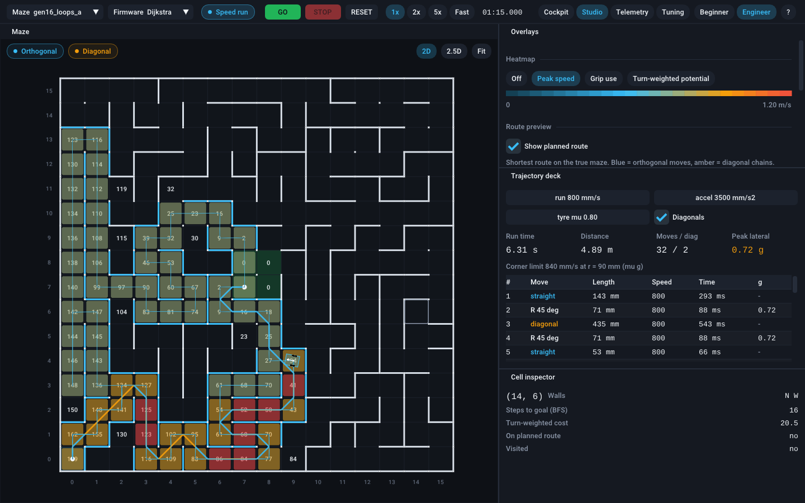
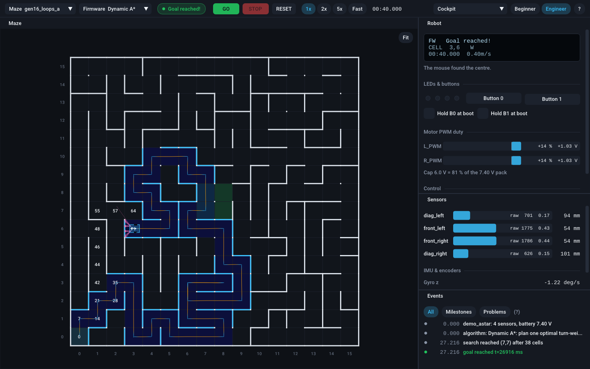
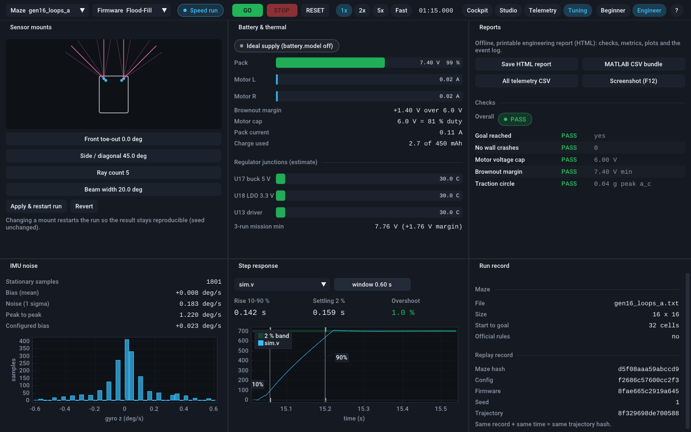

# MMSim - real-time micromouse simulator

[](https://github.com/madukamalruk/micromouse-studio/actions/workflows/ci.yml)
[](LICENSE)

MMSim runs **unchanged micromouse firmware** (pure C11, written against one small HAL header)
on a physics model of the robot, in lockstep, on Windows. The same `.c` files later go onto an
STM32 with a hardware HAL backend. It also drives **mms-protocol solvers** (the
[mackorone/mms](https://github.com/mackorone/mms) text API) on the same physics.



## Features

- **Five solvers to compare**, ready to run (table below), on one shared motion and control stack.
- 2-D and 2.5-D maze view: real against firmware-known walls, cell text and colours the solver
  publishes, sensor beams, heatmaps, planned route, cell inspector.
- Diff-drive physics: DC motors with a 6 V cap, battery and thermal model, tyre slip, continuous
  collision with crash events; IR/ToF sensors, encoders and IMU with seeded noise.
- Firmware as a DLL in lockstep with the physics (1 kHz tick, interrupt, watchdog, hot reload).
- Live telemetry plots, ghost replay of an earlier run, step-response and IMU-noise analysis,
  offline HTML engineering report and a MATLAB CSV bundle.
- Two audiences: **Beginner** mode (one calm screen) and **Engineer** mode (four workspaces).
- `mmsim-cli`: headless batch runs over hundreds of mazes in parallel, JSON and CSV reports.
- Deterministic: same seed + same firmware = the same trajectory hash.

| Cockpit | Tuning and reports |
|---|---|
|  |  |

## The solvers

| Menu name | Folder | Idea | Behaviour |
|---|---|---|---|
| Flood-Fill | `demo_floodfill` | Distance map, always step downhill | Solves every maze here; the reference. |
| Turn-Weighted Dijkstra | `demo_dijkstra` | Prices every 90 degree turn | Same speed-run route as Flood-Fill; the way back may differ. |
| Dynamic A* | `demo_astar` | One optimal plan, replanned when a new wall blocks it | Same results as Dijkstra; replans only when a new wall blocks its plan. |
| Trémaux | `demo_tremaux` | Chalk marks on passages | Always finds the goal; searches much longer on loopy mazes. |
| Wall Follower | `demo_wallfollower` | Left hand on the wall | Solves mazes whose goal touches the outer wall; stops with an error on an island goal. |

Simulated seconds on the original test mazes and on UK 1987 (all with 0 crashes; the full table
is in [docs/benchmarks.md](docs/benchmarks.md), reproduce it with `python tools/benchmark.py`):

| Maze | Algorithm | Search | Return | Speed run |
|---|---|---:|---:|---:|
| gen16_loops_a | Flood-Fill | 27.2 s | 37.8 s | 19.9 s |
| gen16_loops_a | Turn-Weighted Dijkstra | 27.2 s | 31.9 s | 19.7 s |
| gen16_loops_a | Dynamic A* | 27.2 s | 31.9 s | 19.7 s |
| gen16_loops_a | Trémaux | 120.0 s | 24.9 s | 19.9 s |
| gen16_loops_a | Wall Follower | goal is an island: stops with an error | - | - |
| gen16_perfect_a | Wall Follower | 86.6 s | 73.7 s | 60.0 s |
| uk1987f | Flood-Fill | 42.2 s | 34.0 s | 20.7 s |
| uk1987f | Turn-Weighted Dijkstra | 42.2 s | 40.1 s | 20.7 s |
| uk1987f | Dynamic A* | 42.2 s | 40.1 s | 20.7 s |
| uk1987f | Trémaux | 182.9 s | 25.2 s | 20.5 s |
| uk1987f | Wall Follower | goal is an island: stops with an error | - | - |

The planners find the same speed-run route; they differ in which of several equal-cost routes they
take on the way back, and neither wins everywhere (see D15 in [docs/decisions.md](docs/decisions.md)).

## Quick start

### Windows installer (recommended, Windows 10/11, no admin rights)

1. Download `MMSim-v0.2.1-Setup.exe` from the
   [Releases page](https://github.com/madukamalruk/micromouse-studio/releases) and run it.
2. Accept the MIT licence, keep the default folder (`%LOCALAPPDATA%\Programs\MMSim`, no UAC
   prompt) and tick the Desktop shortcut if you want one.
3. Start **Micromouse Studio**, then press **GO** (or Space).

Your settings, runs, reports and screenshots live in `%LOCALAPPDATA%\MMSim\`, so the install
folder stays clean. Uninstall from *Settings > Apps*; the uninstaller asks whether to keep that data.

### Portable zip (Windows 10/11, no installer, no toolchain)

1. Download `mmsim-v0.2.1-win64.zip` from the same page and unzip it anywhere.
2. Double-click `Launch_MMSim.bat`, then press **GO** (or Space).
3. Pick a solver in the *Firmware* menu and a maze in the *Maze* menu.

The zip holds `mmsim.exe`, `mmsim-cli.exe`, the five solver DLLs and a few original test mazes.
It has no runtime dependencies besides `SDL2.dll` (included). The `mmsim.portable` marker keeps
all state next to the exe. The large classic maze collection is not redistributed: see
[Optional maze data](#optional-maze-data).

### From source

Requirements: Windows 10/11 and [MSYS2](https://www.msys2.org) (UCRT64) at `D:\msys64`, or set
`MSYS2_ROOT`:

```powershell
pacman -S mingw-w64-ucrt-x86_64-{gcc,cmake,ninja,SDL2,clang-tools-extra} git python
```

The build uses `cmake/toolchain-msys2-ucrt64.cmake`; nothing is added to the system `PATH`.

```powershell
cmake --preset dev        # Debug (use "release" for speed)
cmake --build --preset dev
ctest --preset dev
build/dev/sim/app/mmsim.exe --maze mazes/test/gen16_loops_a.txt --firmware demo_floodfill
```

Build your own portable zip with `tools/package_release.ps1` (release build, tests, zip, and a
check that it runs with the toolchain removed from `PATH`), and the installer with
`tools/build_installer.ps1` (needs [Inno Setup 6](https://jrsoftware.org/isinfo.php); output in `dist/`).

### Optional maze data

Third-party data is gitignored and fetched on demand:

```powershell
tools/fetch_mazes.ps1      # micromouseonline/mazefiles -> external/mazefiles (no licence: never committed)
tools/fetch_mms_cpp.ps1    # mackorone/mms-cpp (MIT) -> external/mms-cpp, built by the tests
```

## Using it

Keys: Space play/pause, R reset, Ctrl+R rebuild and reload firmware, N run until the next cell,
Right step 10 ms (Shift 100 ms), +/- speed (0.1x-64x, Max), 1-4 workspaces, backtick for the
command console, `?` for the full list, F12 screenshot. The last maze, firmware, seed, speed and
window layout are restored at the next start (`mmsim.json` and `imgui.ini`, gitignored;
`--no-session` disables it). `mmsim.exe --help` lists every option.

An mms solver instead of firmware (any exe speaking the mms stdin/stdout API):

```powershell
build/dev/sim/app/mmsim.exe --maze mazes/test/gen16_loops_a.txt --mms-solver build/dev/tests/mms_cpp_example.exe
```

`--mms-walls sensors` answers wall queries from the simulated sensors instead of the maze.

Headless batch (short solver names work: `--firmware dijkstra`):

```powershell
build/release/sim/cli/mmsim-cli.exe --firmware dijkstra --mazes "mazes/test/*.txt" --jobs 8 --json build/results.json
```

The exit code is 0 only if every maze was solved without a crash or timeout.

## Write your own firmware

1. Create `firmware/<name>/main.c` (more `.c`/`.h` files in the same folder are picked up).
2. Include only `<mmhal/hal.h>` and the C standard library; implement `void fw_main(void)`.
3. `cmake --build --preset dev` produces `build/dev/firmware_bin/<name>.dll`; pick it in the
   Firmware menu or pass `--firmware <name>`.
4. `cmake --build --preset dev --target arm-check` compiles it for Cortex-M4F as well.

```c
#include <mmhal/hal.h>

void fw_main(void) {
    hal_log("hello from %u sensors", (unsigned)hal_sensor_count());
    for (;;) {
        const uint16_t front = hal_get_distance(1);
        const float duty = (front != HAL_DISTANCE_NONE && front < 60) ? 0.0f : 0.25f;
        hal_motor_set_duty(HAL_LEFT, duty);
        hal_motor_set_duty(HAL_RIGHT, duty);
        hal_wait_tick(); /* the main loop must block, or the simulation cannot advance */
    }
}
```

The full contract (units, channel order, timing, what blocks) is in [docs/hal.md](docs/hal.md).
To write a new maze-solving algorithm on the shared stack, read
[firmware/README.md](firmware/README.md). The rules the boundary checker enforces are in
[AGENTS.md](AGENTS.md).

## Layout

```
hal/include/mmhal/hal.h   the only firmware <-> world contract
firmware/common/          shared motion, control, sensors, map and planners (pure C11)
firmware/demo_*/          the five solvers (each -> <name>.dll)
sim/core/                 maze, physics, sensors, world (pure C++20, no OS calls)
sim/host/                 session, firmware host, mms bridge, telemetry, batch runner
sim/platform/             the only Win32 code (fibers, DLLs, child processes)
sim/app/  sim/cli/        GUI (SDL2 + Dear ImGui + ImPlot) and mmsim-cli
config/robots/            robot JSON configs
mazes/test/               original test mazes (tools/gen_mazes.py)
docs/                     prd, plan, decisions, hal, audit, benchmarks, phase2-neomouse
tools/                    benchmark, packaging, maze fetch scripts, boundary checker
```

Design notes and decisions: [docs/decisions.md](docs/decisions.md). Functional and UI audit:
[docs/audit.md](docs/audit.md). Phase 2 (Neomouse V2 on STM32F405):
[docs/phase2-neomouse.md](docs/phase2-neomouse.md).

## Licence

MIT, see [LICENSE](LICENSE). Third-party components and fonts (Roboto, Apache-2.0; Cousine,
SIL OFL 1.1; SDL2, Dear ImGui, ImPlot, nlohmann/json): [THIRD_PARTY_NOTICES.md](THIRD_PARTY_NOTICES.md).
